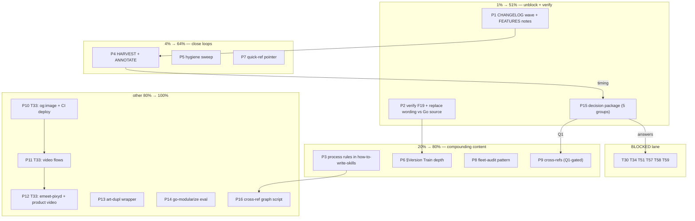

# SUPERB Pareto Plan — go-etag Follow-up + Full Backlog

> 2026-10-17 00:44. Input: `TODO_LIST.md` (8 open items) + the (f) remainder
> of the three 2026-10-17 session reports (20 items) + one gap found during
> Step-0 verification (no CHANGELOG entry exists for the shipped 13-lesson
> go-etag wave). Format: `.md` with mermaid graph per the dispatching prompt
> (overrides the pareto-planning skill's HTML default — explicit user path
> wins, flagged per the same rule status-report records).

## Step-0 verification & errata

- Read: `TODO_LIST.md`, `ROADMAP.md` (7 themes + open questions), CHANGELOG
  `[Unreleased]`, prior plan `2026-09-18_15-01_*`, three session reports.
- **ROADMAP dedupe: clean.** No pre-existing version-train / staircase /
  go-etag-lesson ideas exist in ROADMAP (themes 1–7 skimmed) — this session's
  additions were net-new, nothing to mark.
- **Session-report corrections (for the next HARVEST):** report `00-20` (f)
  items 2, 4, 5, 8, 9, 11 were executed later the same session (§5.5 graph,
  canonical-header, F19, bench baselines, nolint-audit scoping, .gitignore
  marker rule) — they carry no resolution markers yet (see P4).
- **CHANGELOG gap:** the 13-lesson wave (7 skills, 15 files, AGENTS §5.5,
  FEATURES ×2) has no `[Unreleased]` entry — the wave is invisible to the
  documented history (highest-value missing record; P1).
- TODO_LIST T36–T56 confirmed executed (2026-09-24) — not re-dispatched.

## Pareto Breakdown

### The 1% → 51% — unblock decisions + kill the only unverified claims (~2 h)

1. **Decision package** (P15): the 5 open user decisions (session Q1
   exclusions-overrule, Q2 triangle boundary, Q3 docs-health timing; T34
   g1–g3; T57 Q0–Q5) gate 10+ downstream tasks including the whole T57–T59
   website-launch chain. One doc, one sitting, user answers once.
2. **Epistemic verification** (P2): F19's `go get` directive-down-rewrite and
   the go.work "replaced at all versions" error wording are the only two
   claims I encoded this session that are single-sourced (go-etag AGENTS.md /
   in-repo corroboration only). Verify against Go toolchain source or a live
   repro — this repo's core product is verified claims.
3. **CHANGELOG wave entry** (P1): record the shipped value.

### The 4% → 64% — close every verification loop this session opened (~2.5 h)

P4 HARVEST+ANNOTATE (the reports age in minutes), P5 hygiene sweep
(markdownlint diff, full `--signal`, GitHub render pass, CHANGELOG
expectations check), P1 remainder (FEATURES dated notes ×2), P7 quick-ref
pointer. None of it is new thinking — all of it is finishing.

### The 20% → 80% — compound-interest content (~4 h)

P3 process upgrades (edit-before-read rule + lesson×skill coverage matrix
into how-to-write-skills.md — prevents the round-3 miss class repo-wide),
P6 §Version Train depth (worked go.work example, CI-mode table), P8
fleet-audit pattern, P9 pending cross-refs.

### The other 80% → 100%

T33 site-repo follow-ups (P10–P12), P13 art-dupl wrapper, P14 go-modularize
eval, P16 ROADMAP theme-4 cross-ref graph prototype, externally-triggered T30,
and the BLOCKED chain T34/T51/T57–T59 (unlocked by P15).

## Comprehensive Plan (30–100 min packages — ALL TODOs included)

Sorted by importance → impact → customer-value (skill trustworthiness first),
then effort. "Cust-value" = who benefits: A = every future agent session,
R = repo hygiene, U = end users of the sites/videos.

| P# | Package (30–100 min) | Covers | Impact | Effort | Cust-value | Deps |
| -- | -------------------- | ------ | ------ | ------ | ---------- | ---- |
| P1 | CHANGELOG `[Unreleased]` wave entry (13 lessons, 7 skills, AGENTS/FEATURES) + FEATURES dated notes for how-to-golang + go-release staircase note | f4, f7, CHANGELOG gap | High | 45m | R/A | — |
| P2 | Verify F19 directive-down-rewrite + "replaced at all versions" wording against Go source / live repro; fix skill text if off | f9, f15 | High | 60m | A | — |
| P15 | Assemble the decision package: session Q1–Q3 + T34 g1–g3 + T57 Q0–Q5 into one doc with recommendations | unblocks T34/T51/T57–T59 | High | 45m | A/U | — |
| P3 | Encode edit-before-read (3× pattern) + lesson×skill coverage-matrix step into how-to-write-skills.md | f3, f8 | High | 90m | A | — |
| P4 | docs-health HARVEST over the four 2026-10-17 docs; ANNOTATE executed (f) items; archive if fully resolved | f2 (+Q3 timing) | High | 75m | A/R | Q3 or user go-ahead |
| P5 | Hygiene sweep: markdownlint diff-check (15 files vs baseline), full `--signal` review, GitHub render pass (3 reference files), CHANGELOG-expectations check for skill edits | f5, f6, f17, f18 | Medium | 60m | R | — |
| P6 | go-modularize §Version Train depth: full worked go.work example + CI-mode table (workspace mid-cycle vs GOWORK=off at release) | f13, f19 | Medium | 45m | A | — |
| P7 | go-release quick-reference.md staircase one-liner | f14 | Low | 30m | A | — |
| P8 | go-ecosystem-upgrade: fleet-audit pre-major pattern (`rg -l 'repo" v' -g go.mod`) into the major-version phase | f10 | Medium | 30m | A | — |
| P9 | Cross-refs pending Q1: bdd-testing → spec-implementation section; collector-extraction → §Extraction without breakage | f11, f12 | Low | 30m | A | Q1 |
| P10 | T33 part 1: emeet og:image-from-poster + CI deploy workflow (kill manual-deploy class) | T33 | Medium | 100m | U | T33 site access |
| P11 | T33 part 2: video flows for go-atomic-write / go-filewatcher | T33 | Medium | 100m | U | P10 |
| P12 | T33 part 3: recreate emeet-pixyd composition from surviving MP4 + first 20–30s product video | T33 | Medium | 100m | U | site choice (ROADMAP) |
| P13 | art-dupl `--expect-groups N` wrapper (make enforced-count acceptance mechanical) | f16 | Medium | 60m | A | — |
| P14 | go-modularize eval: version-train strategy decisions (mirrors go-release evals) | f20 | Low | 100m | A | — |
| P16 | ROADMAP theme-4: skill cross-reference graph script prototype (mechanize §5.5) | ROADMAP raw idea | Medium | 100m | A/R | — |
| B1 | BLOCKED lane (no package until decisions): T30 (external trigger), T34, T51, T57, T58, T59 | TODO_LIST | High (once unblocked) | — | A/U | P15 + user |

## Micro Breakdown (≤12 min per task — ALL TODOs included)

| # | Task (≤12 min) | Pkg | Sort key |
| - | -------------- | --- | -------- |
| 1 | Draft CHANGELOG Added block: 13 lessons, 7 skills, file list from session reports | P1 | H/R |
| 2 | Add 2026-10-17 dated note to how-to-golang FEATURES row (4 additions, 5 files) | P1 | H/R |
| 3 | Add staircase mention to go-release FEATURES row | P1 | M/R |
| 4 | Re-run check-skills.sh; quote exit | P1 | H/R |
| 5 | Locate Go source for go get's go-directive rewrite (cmd/go, module graph pruning) | P2 | H/A |
| 6 | Confirm the rewrite-down behavior wording; correct F19 if needed | P2 | H/A |
| 7 | Live-repro go.work `use`+replace conflict; capture exact "replaced at all versions" wording | P2 | H/A |
| 8 | Correct go-release/go-modularize replace-rule wording if the repro disagrees | P2 | H/A |
| 9 | Write decision-package doc skeleton with the 5 decision groups + recommendation each | P15 | H/A |
| 10 | Fill session Q1 (4 exclusions) with pros/cons from report 00-26 §a6 | P15 | H/A |
| 11 | Fill session Q2 (triangle boundary) with §5.5 rationale summary | P15 | H/A |
| 12 | Fill T34 g1–g3 section from 2026-09-09 report | P15 | H/A |
| 13 | Fill T57 Q0–Q5 section from 2026-10-11 reconciliation doc | P15 | H/A |
| 14 | Add Q3 (docs-health timing) + decision-ask checklist; save to docs/planning/ | P15 | H/A |
| 15 | Draft edit-before-read rule ("bash output ≠ read; only View counts; 3× this session") | P3 | H/A |
| 16 | Draft lesson×skill coverage-matrix step ("before editing: matrix lessons→owning skill + exclusions w/ reasons") | P3 | H/A |
| 17 | Find insertion points in how-to-write-skills.md (Principle 7 area + authoring checklist) | P3 | H/A |
| 18 | Insert both rules; keep signal density; re-read rendered | P3 | H/A |
| 19 | Run check-skills.sh + check-agents-md.sh; quote exits | P3 | H/R |
| 20 | HARVEST: scan 4 docs for harvestable items; skip resolution-marked ones | P4 | H/A |
| 21 | HARVEST: route items to TODO_LIST vs ROADMAP per docs-health rules | P4 | H/A |
| 22 | ANNOTATE report 00-20: strike f2/f4/f5/f8/f9/f11 as done-at-session | P4 | H/A |
| 23 | ANNOTATE reports 00-26 + work report for executed items | P4 | H/A |
| 24 | Archive fully-resolved reports via git mv per ANNOTATE | P4 | M/R |
| 25 | markdownlint on the 15 session files; diff against repo noise baseline | P5 | M/R |
| 26 | Full --signal read; confirm my edited skills show 0 advisories | P5 | M/R |
| 27 | GitHub render pass: multi-module.md, real-world-patterns.md, failure-mode-catalog.md | P5 | M/R |
| 28 | Check whether repo convention wants CHANGELOG entries for skill edits; record answer | P5 | L/R |
| 29 | Draft full go.work example (5 modules, version-qualified replaces) for §Version Train | P6 | M/A |
| 30 | Draft CI-mode table (workspace mid-cycle vs GOWORK=off release) | P6 | M/A |
| 31 | Insert both; TOC/anchor check; gate | P6 | M/A |
| 32 | Add staircase one-liner + link to go-release quick-reference.md | P7 | M/A |
| 33 | Add fleet-audit `rg -l` pattern to go-ecosystem-upgrade major-version phase | P8 | M/A |
| 34 | Cross-ref bdd-testing → how-to-golang §Spec-Implementation Testing | P9 | L/A |
| 35 | Cross-ref collector-extraction → go-modularize §Extraction without breakage | P9 | L/A |
| 36 | emeet og:image-from-poster upgrade | P10 | M/U |
| 37 | CI deploy workflow skeleton (build + deploy on push) | P10 | M/U |
| 38 | Wire workflow; verify one clean run | P10 | M/U |
| 39 | Storyboard go-atomic-write video flow | P11 | M/U |
| 40 | Build go-atomic-write video flow | P11 | M/U |
| 41 | Storyboard + build go-filewatcher video flow | P11 | M/U |
| 42 | Recover emeet-pixyd MP4; commit under website/video/ | P12 | M/U |
| 43 | Recreate composition from MP4 reference | P12 | M/U |
| 44 | Scope first 20–30s product video (site per ROADMAP Q) | P12 | M/U |
| 45 | art-dupl wrapper: count-groups mode (parse report, compare to expected N) | P13 | M/A |
| 46 | Wrapper self-test on a fixture | P13 | M/A |
| 47 | go-modularize eval: design 3 version-train scenario prompts | P14 | L/A |
| 48 | Run + grade eval; record scores | P14 | L/A |
| 49 | Cross-ref graph script: parse SKILL.md links → graphviz/mermaid output | P16 | M/A |
| 50 | Add --check mode: diff vs committed graph; wire once stable | P16 | M/A |

Blocked lane (not scheduled): T30, T34, T51, T57, T58, T59 — waiting on P15
answers / external triggers. T33 site access assumed available.

## Execution graph

## Verification (per wave)

- After every package: `scripts/check-skills.sh` (echo `$?`), and
  `scripts/check-agents-md.sh` when AGENTS/how-to-write-skills touched.
- P2 done = both claims carry a Go-source or repro citation inside the skill
  text (verify-external-claims standard).
- P4 done = TODO_LIST updated, reports carry resolution markers, CHANGELOG
  notes the harvest.
- Content edits: signal-density re-read of every touched skill body.

## Risk notes (VERSCHLIMMBESSER guardrails)

- No rewrites of shipped lesson content while merely "tidying" — only
  corrections backed by P2 verification.
- HARVEST must not resurrect already-executed items into TODO_LIST (skip
  resolution-marked ones — the exact anti-pattern docs-health documents).
- P16 script is a prototype: graph output first, `--check` enforcement only
  after the graph is trusted (matches ROADMAP theme-2's enforcement-level
  question).
- Do not push the BLOCKED lane into fake progress — T30 is externally
  triggered by design.
