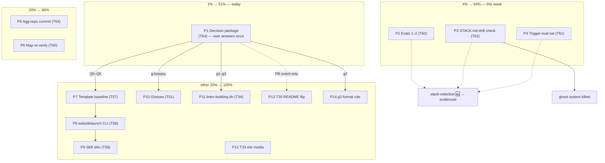

# SUPERB Pareto Plan — Decision Unblock + stack-selection Hardening

> 2026-10-27 21:56. Input: `TODO_LIST.md` (11 open items: T30, T33, T34, T51,
> T57–T63) + ROADMAP open questions (g1–g4) + self-review findings
> (`docs/reviews/2026-10-27_21-44_*`). Format: `.md` with mermaid graph per the
> dispatching prompt (overrides the pareto-planning skill's HTML default —
> explicit user path wins, flagged per the same rule the 2026-10-17 and
> 2026-10-24 plans record). Fine-granularity cap: 12 min (user demand, stricter
> than the skill's 15).

## Step-0 verification & errata

- Read: `TODO_LIST.md` (full), `ROADMAP.md` open questions, prior plans
  `2026-10-17_00-44_*` and `2026-09-18_15-01_*` (format + still-open items),
  CHANGELOG grep for every T-number.
- **All 11 TODO items verified open**: T60 (only `evals.json`, no
  iteration-2), T61 (no `trigger-eval.json`), T62 (no `scripts/` dir),
  T63 (aggregation repo still on stale branch `docs-health-verify-legs`,
  67 dirty files), T57–T59 (ROADMAP line ~163: decision package PREPARED
  2026-10-11, still unanswered), T30/T33/T34/T51 (TODO_LIST evidence columns
  - CHANGELOG: no completion entries).
- **Errata / recurring pattern**: the 2026-10-17 plan's #1 item (1%→51%) was
  the SAME consolidated decision package — it went unanswered for 10 days and
  its tasks re-appear here. This plan re-surfaces it as P1 with a sharper
  framing: the decisions are now 17 days old and gate 6 of 11 TODOs.
- **New tasks surfaced by planning** (added to TODO_LIST as T64/T65 per the
  plan-skill's wiring rule): decision-package consolidation (P1) and
  capability-map re-verify pass (P6).

## Pareto Breakdown

### The 1% → 51% — ONE sitting of user decisions (~60 min of prep, 15 min of Lars)

**P1 — Consolidated decision package.** One document, every open decision,
one recommendation each, user answers once. Gates: T57+T58+T59 (the whole
website-launch template chain), T34 (3 questions), T51 (glossary lockstep),
T30 (partially), ROADMAP g1–g4 (backup retention, third-party policy,
link-state enforcement, status-report format — g2 has 8 documented
recurrences and the user has now demanded `.md` twice). Six of eleven TODOs
plus four ROADMAP questions move from BLOCKED to executable. Nothing else in
the backlog has this unblock ratio.

### The 4% → 64% — harden the newest skill before its first real user (~4 h)

**P2+P3+P4 — the stack-selection trilogy.** The skill shipped yesterday is
the most likely to fire next (new projects happen constantly; it triggers on
"new project"). Today it is: unverified behaviorally (evals 1–2 unrun — T60),
trigger-untested (T61), and its core output is a ghost system (STACK.md has
no reader — T62). Executing all three turns 🆕 into evidenced 🟢-track and
kills the ghost. This is the 4% because it is one skill, three tasks, one
evening — and it protects every future project's foundation decisions.

### The 20% → 80% — the above plus hygiene (~6 h total)

Add P5 (aggregation-repo commit — closes the fan-out ledger), P6
(capability-map re-verify pass — the map's own "documented neglect" risk,
caught by the self-review), and the P1-gated quick executions P10 (T51) and
P11 (T34) once decisions land.

### The other 20% → 100% — big gated builds + visible media (~6 h, mostly queued)

P7–P9 (website-launch template chain, ~4 h, gated on P1 Q0–Q5), P12 (T33
site-repo media follow-ups — real customer-visible work, independent of all
gates), P13 (T30 README flip — gated on a real upstream PR event, not on us),
P14 (status-report format execution — gated on P1/g2).

## Comprehensive Plan — Level 1 (30–100 min each, ALL TODOs, sorted)

Sorted by importance/impact/effort/customer-value. "Gate" = cannot start
until the named task's outcome.

| #   | Task                                                                                                                     | TODO ref  | Impact | Effort   | Customer value (Lars using his skills)                                            | Gate     |
| --- | ------------------------------------------------------------------------------------------------------------------------ | --------- | ------ | -------- | --------------------------------------------------------------------------------- | -------- |
| P1  | Consolidated decision package: one doc, all decisions, recommendations, user answers once; route answers to TODO/ROADMAP | NEW (T64) | ★★★★★  | M (60m)  | Unblocks 6 of 11 TODOs + 4 ROADMAP questions; 17 days of waiting ends             | —        |
| P2  | stack-selection evals 1–2 in subagent mode + assertions + improve-from-failures loop                                     | T60       | ★★★★★  | M (90m)  | Newest skill becomes behaviorally evidenced; the hard multi-lib case finally runs | —        |
| P3  | STACK.md drift-check script (go.mod ⊆ STACK.md) + full-code-review consumer wiring                                       | T62       | ★★★★★  | M (75m)  | Kills the ghost system; STACK.md becomes enforceable, not decorative              | —        |
| P4  | Trigger-eval set (20 queries, near-misses vs 3 neighbor skills) + description optimization                               | T61       | ★★★★☆  | M (90m)  | The skill only delivers value if it fires; near-miss testing is the difference    | —        |
| P5  | Aggregation-repo: commit stack-selection symlink on master (worktree, no WIP mixing)                                     | T63       | ★★☆☆☆  | S (30m)  | Fan-out ledger complete; cosmetic per doctrine but 5-minute honesty               | —        |
| P6  | Capability-map re-verify pass: script diffing map rows vs `meta list` JSON; update gaps + date                           | NEW (T65) | ★★★☆☆  | S (45m)  | Map self-declares as navigation — make re-verification cheap and repeatable       | —        |
| P7  | website-launch stage 1: extract chosen template baseline into CI-green template repo                                     | T57       | ★★★★☆  | L (100m) | Foundation of the whole template overhaul; ships reusable value                   | P1       |
| P8  | website-launch stage 2: `websitelaunch` CLI (doctor/init/check), validate against source site                            | T58       | ★★★★☆  | L (100m) | Turns the 848-line skill into code-enforced checks                                | P7       |
| P9  | website-launch stage 3: skill slim (Phase 3 → scaffold instructions, absorb refs, re-run evals)                          | T59       | ★★★☆☆  | M (60m)  | Closes the ROADMAP 848-line question; skill becomes maintainable                  | P8       |
| P10 | Execute T51 per decision: align 7 first-use glosses verbatim OR amend Principle 7 rule                                   | T51       | ★★★☆☆  | S (30m)  | Ends the glossary-lockstep ambiguity across all skills                            | P1       |
| P11 | Execute T34 per decision: Go-first vs multi-language, eval aging, commit ownership                                       | T34       | ★★★☆☆  | S (45m)  | linter-building direction locked; eval investment de-risked                       | P1       |
| P12 | T33 site-repo: emeet-pixyd composition rebuild from MP4 + first product video + og:image + CI deploy                     | T33       | ★★★☆☆  | L (100m) | Customer-visible: websites are what sell the libs                                 | —        |
| P13 | T30: flip jj-fork-pr README 🆕→🟢 after first real green upstream PR (run note)                                          | T30       | ★☆☆☆☆  | XS (15m) | Honesty of the skill inventory                                                    | external |
| P14 | Execute ROADMAP g2 per decision: amend status-report default (or keep HTML + note the .md demand pattern)                | g2/T—     | ★★★☆☆  | S (30m)  | Ends the 8×-recurring format fight                                                | P1       |

## Fine Breakdown — Level 2 (≤12 min each, ALL tasks, sorted by parent priority)

Subtask IDs are `P#.step`; execute in table order within a parent; parents in
P1→P14 order. Gated parents (P7–P11, P13, P14) execute after P1 answers.

| ID    | Subtask                                                                                                             | Est | Output / done-criterion                                |
| ----- | ------------------------------------------------------------------------------------------------------------------- | --- | ------------------------------------------------------ |
| P1.1  | Collect all open decisions (T34 g1–g3, T51, T57 Q0–Q5, g1–g4, T30 note) into a skeleton doc with question + options | 12m | `docs/decisions/2026-10-27_open-decisions.md` skeleton |
| P1.2  | Draft recommendation + tradeoffs: T57 Q0–Q5 (template baseline questions)                                           | 12m | recommendations filled, evidence-linked                |
| P1.3  | Draft recommendations: T34 g1–g3, T51, ROADMAP g1–g4                                                                | 12m | same                                                   |
| P1.4  | Verify every recommendation's claims against repo evidence (grep, counts)                                           | 12m | no unverified claim in the doc                         |
| P1.5  | Present to user in one batch; capture answers inline                                                                | 12m | every question has a verdict                           |
| P1.6  | Route answers: flip TODO statuses, resolve ROADMAP questions, CHANGELOG row                                         | 12m | TODO_LIST/ROADMAP reflect decisions                    |
| P2.1  | Snapshot skill; create `stack-selection-workspace/iteration-2/` dirs                                                | 6m  | workspace ready                                        |
| P2.2  | Spawn eval-1 (lib-watching CLI) with-skill + baseline subagents, same turn                                          | 8m  | both runs launched                                     |
| P2.3  | Spawn eval-2 (event-sourced web app) with-skill + baseline, same turn                                               | 8m  | both runs launched                                     |
| P2.4  | Draft assertions per eval while runs execute                                                                        | 12m | eval_metadata.json + evals.json updated                |
| P2.5  | Capture timing.json per completion notification                                                                     | 5m  | timing per run                                         |
| P2.6  | Grade runs vs assertions programmatically; write grading.json                                                       | 12m | pass/fail per assertion with evidence                  |
| P2.7  | Improve skill from failures; re-run failed evals once                                                               | 12m | iteration-2 green or documented residual               |
| P2.8  | Update FEATURES row evidence + CHANGELOG entry                                                                      | 10m | docs current                                           |
| P3.1  | Design drift-check contract: inputs, exit codes (0 clean / 1 undeclared / 2 no STACK.md), output format             | 12m | contract written into script header                    |
| P3.2  | Write `stack-selection/scripts/stack-drift-check.sh` (parse go.mod requires + STACK.md tables; shfmt-clean)         | 12m | script runs on fixture                                 |
| P3.3  | Fixture tests: clean repo / undeclared dep / excluded-with-reason accepted                                          | 12m | 3 fixtures pass                                        |
| P3.4  | Wire into SKILL.md Phase 5 + done bar; mention in assets template header                                            | 8m  | skill references its own check                         |
| P3.5  | full-code-review: add "read STACK.md if present, flag undeclared deps" step                                         | 10m | consumer exists                                        |
| P3.6  | Run check against eval fixture STACK.md + one real project with STACK.md                                            | 10m | real-world run recorded                                |
| P3.7  | shfmt + check-skills gate + CHANGELOG row                                                                           | 8m  | gate EXIT 0                                            |
| P4.1  | Draft 10 should-trigger queries (realistic, varied length, typos, lowercase)                                        | 12m | queries drafted                                        |
| P4.2  | Draft 10 near-miss should-not-trigger (vs how-to-golang, library-deep-dive, go-ecosystem-upgrade)                   | 12m | near-misses genuinely tricky                           |
| P4.3  | Save `evals/trigger-eval.json`; self-review the set once                                                            | 5m  | file saved                                             |
| P4.4  | Run trigger evaluation round 1 (3× per query for stability)                                                         | 12m | trigger rates recorded                                 |
| P4.5  | Revise description from misses; run round 2                                                                         | 12m | improved rates                                         |
| P4.6  | Revise + run round 3; stop when test score plateaus                                                                 | 12m | best description chosen on held-out                    |
| P4.7  | Apply best description; re-run check-skills --triggers + gate                                                       | 10m | STRONG rating preserved, gate EXIT 0                   |
| P5.1  | Worktree the aggregation repo at master (do NOT touch `docs-health-verify-legs` WIP)                                | 12m | clean master worktree                                  |
| P5.2  | Commit the stack-selection symlink on master with detailed message                                                  | 10m | symlink tracked                                        |
| P5.3  | Remove worktree; re-run `link-skills-to-agents.sh --check` from SKILLS repo                                         | 5m  | check green                                            |
| P6.1  | Script: extract lib names from capability-map tables vs `meta list --format json`                                   | 12m | diff produced                                          |
| P6.2  | Classify diffs: new-in-meta-unmapped / mapped-but-gone / renamed                                                    | 12m | classified list                                        |
| P6.3  | Update map rows + Known-gaps section + date stamp                                                                   | 12m | map current                                            |
| P6.4  | Record cadence recommendation (re-run after every meta `lib`-tag change) in AGENTS §5.5 entry                       | 5m  | note exists                                            |
| P7.1  | Create template repo from the P1-Q0-chosen baseline; initial commit                                                 | 12m | repo exists                                            |
| P7.2  | Strip project-specifics; parametrize site name/assets                                                               | 12m | generic skeleton                                       |
| P7.3  | Wire CI (deploy + checks); iterate to green, part 1                                                                 | 12m | CI runs                                                |
| P7.4  | Iterate CI to green, part 2 (fix flaky steps)                                                                       | 12m | CI green                                               |
| P7.5  | Verify clean-checkout build (fresh clone → build → deploy dry-run)                                                  | 12m | acceptance met                                         |
| P8.1  | Scaffold `websitelaunch` CLI in template repo (stdlib-only, hard-capped)                                            | 12m | skeleton compiles                                      |
| P8.2  | Implement `doctor` (Phase 0 checks as code)                                                                         | 12m | doctor runs                                            |
| P8.3  | Implement `init` (scaffold from template)                                                                           | 12m | init produces site                                     |
| P8.4  | Implement `check` (DoD/Phase 4 as code)                                                                             | 12m | check validates                                        |
| P8.5  | Validate `check` against the extraction-source site; fix findings                                                   | 12m | validation recorded                                    |
| P9.1  | Rewrite website-launch Phase 3 → scaffold instructions pointing at CLI                                              | 12m | Phase 3 slim                                           |
| P9.2  | Absorb references per disposition tables (T57 proposal)                                                             | 12m | refs absorbed                                          |
| P9.3  | Update FEATURES row + README; re-run `evals/`                                                                       | 12m | docs + evals current                                   |
| P9.4  | Close ROADMAP 848-line question with resolution note                                                                | 8m  | question closed                                        |
| P9.5  | Gate + CHANGELOG                                                                                                    | 8m  | gate EXIT 0                                            |
| P10.1 | Apply the decided gloss path: align 7 glosses OR amend Principle 7 rule                                             | 12m | decision executed                                      |
| P10.2 | Re-run `check-skills.sh --signal`; verify no jargon regressions                                                     | 8m  | signal clean                                           |
| P10.3 | Flip T51 status; CHANGELOG row                                                                                      | 6m  | TODO_LIST current                                      |
| P11.1 | Record linter-building direction decisions in its SKILL.md/references                                               | 12m | direction locked                                       |
| P11.2 | Adjust eval-aging + commit-ownership conventions per verdict                                                        | 12m | conventions written                                    |
| P11.3 | Flip T34 status; CHANGELOG row                                                                                      | 6m  | TODO_LIST current                                      |
| P11.4 | ROADMAP: close g-question remnants if resolved                                                                      | 6m  | ROADMAP current                                        |
| P12.1 | Rebuild emeet-pixyd HyperFrames composition from surviving MP4 (commit under `website/video/`)                      | 12m | composition committed                                  |
| P12.2 | Continue composition rebuild (timing/media sync pass)                                                               | 12m | renders                                                |
| P12.3 | First 20–30s product video: pick site (per P1 if answered), script beats                                            | 12m | script + site chosen                                   |
| P12.4 | Render + iterate product video, part 1                                                                              | 12m | draft render                                           |
| P12.5 | Render + iterate product video, part 2; embed on site                                                               | 12m | live on site                                           |
| P12.6 | emeet og:image-from-poster upgrade + go-atomic-write/go-filewatcher video flows + CI deploy workflow decision       | 12m | T33 remainder dispositioned                            |
| P13.1 | After first green real upstream PR: write run note, flip README 🆕→🟢                                               | 8m  | README honest                                          |
| P13.2 | Flip T30 status; CHANGELOG row                                                                                      | 5m  | TODO_LIST current                                      |
| P14.1 | Apply g2 verdict: amend status-report default format (or codify .md-on-demand rule)                                 | 12m | skill amended                                          |
| P14.2 | Update FEATURES/README rows + ROADMAP resolution                                                                    | 10m | docs current                                           |
| P14.3 | Gate + CHANGELOG                                                                                                    | 8m  | gate EXIT 0                                            |

68 subtasks, all ≤12 min. Total estimated: ~11.5 h (≈5.5 h ungated P1–P6, ≈6 h
gated/queued P7–P14).

## Execution graph

## Post-plan wiring

- **T64** (decision package, P1) and **T65** (map re-verify, P6) added to
  `TODO_LIST.md` — the plan is a snapshot; TODO_LIST is the living source.
- Gate results (P1 answers) route back via status flips, not edits to this
  plan (docs-health ANNOTATE owns re-annotation later).

_Verschlimmbesserung guard: no TODO status was flipped, no ROADMAP question
resolved, no skill edited by this plan — it only sorts and decomposes.
Everything actionable stays exactly as open as Step-0 found it._
